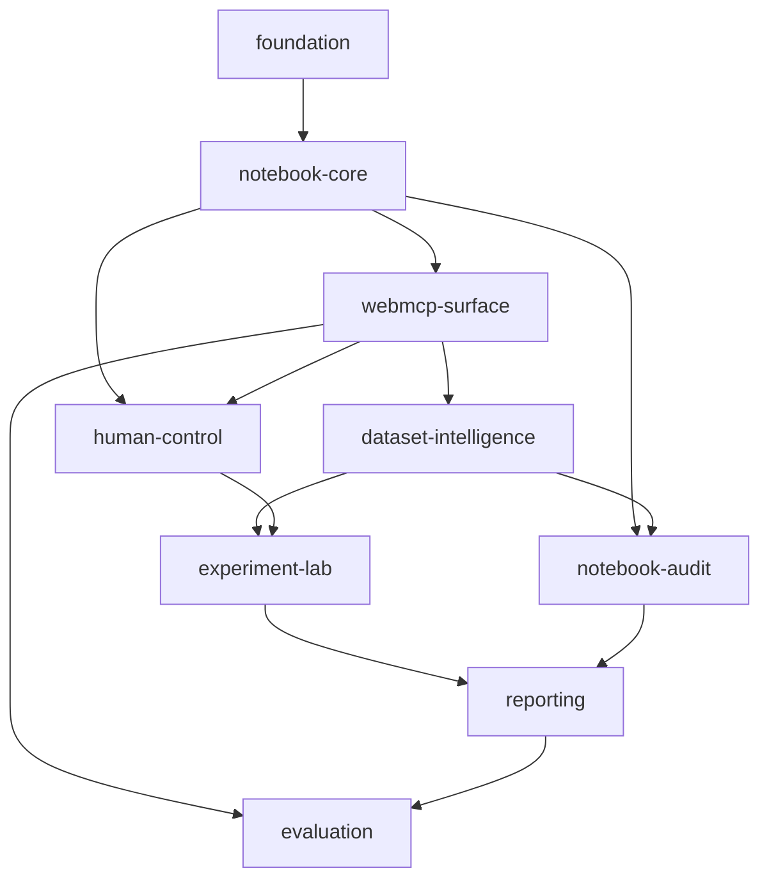

# Capability Map: NotebookPilot

## Assumptions

1. The first release is a browser-only JupyterLite application with no custom backend.
2. ChatGPT site tools are the first supported agent connection.
3. WebMCP is the bridge between ChatGPT and the open notebook.
4. Python runs locally in the browser through Pyodide.
5. CSV is the only dataset upload format required by the first usable release.
6. The first release supports supervised classification experiments only.
7. The human must review agent-proposed notebook changes before they are applied.
8. Dataset contents are not sent to an external service by NotebookPilot itself; ChatGPT receives only information returned through approved WebMCP tool calls.

## Modules

| Module id | Responsibility | Depends on |
|---|---|---|
| `foundation` | Repository, JupyterLite build, extension packaging, local development, CI, and demo deployment | None |
| `notebook-core` | Read live notebooks, identify cells, hash revisions, propose edits, apply approved edits, and run visible cells | `foundation` |
| `webmcp-surface` | Register browser site tools, validate arguments, return bounded results, and expose structured errors | `notebook-core` |
| `human-control` | Proposal review, permissions, visible activity, diffs, provenance, and approval states | `notebook-core`, `webmcp-surface` |
| `dataset-intelligence` | Load CSV data, profile columns, find missing values, duplicates, imbalance, outliers, and leakage risks | `webmcp-surface` |
| `experiment-lab` | Run approved classification experiments, record parameters and metrics, and compare results | `dataset-intelligence`, `human-control` |
| `notebook-audit` | Score reproducibility, documentation, execution order, random seeds, hard-coded paths, and risky operations | `notebook-core`, `dataset-intelligence` |
| `reporting` | Generate a bounded HTML and Markdown report from dataset, audit, and experiment results | `experiment-lab`, `notebook-audit` |
| `evaluation` | Test tool selection, argument correctness, edit scope, execution results, and agent reliability | `webmcp-surface`, `reporting` |

## Dependency graph

## Build order

1. `foundation`
2. `notebook-core`
3. `webmcp-surface`
4. `human-control`
5. `dataset-intelligence`
6. `experiment-lab`
7. `notebook-audit`
8. `reporting`
9. `evaluation`

## First milestone

The first milestone ends after `dataset-intelligence` and must demonstrate this complete flow:

1. The user opens NotebookPilot in ChatGPT's built-in browser.
2. The user uploads a CSV into the JupyterLite workspace.
3. ChatGPT discovers NotebookPilot's WebMCP tools.
4. ChatGPT asks the application to profile the dataset.
5. The application returns a bounded structured profile.
6. ChatGPT proposes a visible notebook cell that cleans one detected issue.
7. The user reviews and accepts the diff.
8. The application executes the approved cell and shows the output.

## Out of scope for the first milestone

- A built-in chat interface
- Direct OpenAI API integration
- Accounts, teams, or cloud notebook storage
- A production backend or database
- Regression, clustering, deep learning, or generative-model training
- Arbitrary shell execution
- Background autonomous agents
- Mobile support

