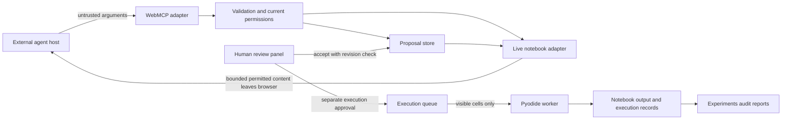
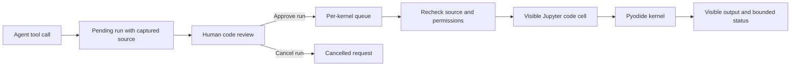

# Architecture decisions and trust boundaries

Status: intended product architecture, with only the static JupyterLite foundation implemented.

## ADR 001: Browser runtime

Use JupyterLite/Pyodide with a prebuilt JupyterLab extension. This preserves a real notebook UI without a production Python server. Limitations: browser memory, available WebAssembly packages, browser storage eviction, and no Colab GPU. A local HTTP server serves assets only. Internet is needed for uncached runtime assets; do not claim offline support until assets are vendored and tested.

## ADR 002: Keep protocol out of domain logic

Notebook operations, policy, proposals and execution records do not import host APIs. The WebMCP adapter validates input and translates results. Human-control and data modules depend on domain interfaces; registration composes their handlers after initialization. CAPABILITY_MAP.md arrows describe delivery order, not TypeScript import requirements. This avoids a WebMCP ↔ permissions dependency cycle.

## ADR 003: Human actions own authority

The host may request a proposal or run but cannot grant permissions or approve either. Policies live outside imported notebook metadata. Revalidate scope, cell existence and source hashes immediately before applying or executing. Approval is single-use and scoped to exact content. Restart/close invalidates pending work. Tool guards do not sandbox Python: visible approved code can access its runtime; scanning only warns about risk.

## ADR 004: Evidence and data lifecycle

Profiles identify original dataset bytes; experiments identify dataset, split, code and versions. Store run records in browser storage under versioned keys, without raw rows by default. Handle quota errors without claiming persistence succeeded. Provide user-visible deletion/export. Clearing site data removes these records. Reports are explicit local downloads and never automatically uploaded.

## ADR 005: Host compatibility is an integration gate

The [WebMCP draft](https://webmachinelearning.github.io/webmcp/) inspected on 2026-10-23 exposes document.modelContext. The [upstream project](https://github.com/alliecatowo/jupyterlite-web-mcp) is a reference, not proof our host works. Verify the actual browser's API shape and cancellation/result semantics in W1. Do not silently substitute a shim or promise support across browsers. Protocol fixtures must record the draft and host version used.

## Failure paths

Malformed/oversize input fails before lookup or parsing. Hidden and unknown objects share NOT_FOUND responses. Stale approvals cancel without mutation. Execution timeout interrupts only the owned queue, records failure and preserves visible output. Storage failures remain visible. Unsupported API disables tools without disabling the notebook. Output limits return explicit truncation or reject an indivisible result; they never silently remove warnings.
# Execution approval boundary

The agent can create a pending run request and read its result. Only the sidebar human control invokes queue approval. Captured code is shown before approval; dispatch rechecks permissions, source and kernel identity. The live adapter executes the visible Jupyter CodeCell and attaches output to that cell. Tool results contain bounded summaries. Cancellation requests an interrupt only when the adapter has observed its own execution and no unrelated execute request; otherwise the queue retains the kernel lane until settlement.

## ADR 006: Shared-memory hosting for runtime interruption

The local static server sends Cross-Origin-Opener-Policy: same-origin and Cross-Origin-Embedder-Policy: require-corp. These enable SharedArrayBuffer in the page and worker on localhost. The browser test executes Python to verify the worker's actual isolation and ability to allocate shared memory; it also preserves the sample CSV execution check. Production hosting must supply these headers over HTTPS and verify CDN/package compatibility again.

This does not implement runtime cancellation by itself. The pinned LiteKernelClient interrupt only cancels queued messages. The remaining implementation needs an explicitly initialized Pyodide interrupt buffer shared with the main thread and scoped to the current kernel. Use Pyodide's setInterruptBuffer API, reset signal state at the execution boundary, and retain the ownership checks before signalling. Do not replace live interruption with an automatic restart, inject hidden Python, modify a global Worker constructor, or blindly rewrite minified third-party bundles. Prefer a small source-level kernel extension using upstream exported classes and a separately built worker; preserve upstream notices if source adaptation becomes necessary. Verify interruption, preserved variables, subsequent execution, disposal and kernel replacement.

