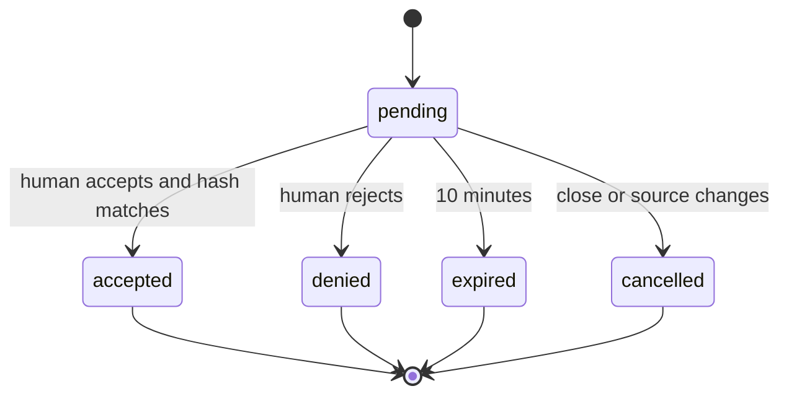

# WebMCP contract v0.1

All inputs are closed JSON objects: reject unknown fields, wrong types, non-finite numbers and invalid IDs. notebookId/cellId/datasetId/runId/proposalId are opaque strings, max 128 characters; never interpret them as paths. Every lookup checks the current permission before reading data. Version this document with schema changes.

Machine-readable input schemas are in contracts/tools.json (JSON Schema 2020-12). They are a planned contract, not registered tools. requestId, executionId and exportId use the same nonempty opaque-ID rule. Source hashes are lowercase 64-digit SHA-256 hex. JSON Schema maxLength counts characters: the runtime must additionally enforce x-maxUtf8Bytes in UTF-8 bytes. Reject duplicate cell IDs within an execution request. Schema defaults are applied explicitly by the adapter, never assumed to mutate input.

An execution request's requestId is also its executionId in execution records and experiment_record; do not generate two unrelated identifiers. afterCellId:null inserts at the start. Insertion proposals capture the notebook cell-order revision and reject if that order changes before approval. Read pagination orders visible cells only, so offsets never disclose hidden positions.

The envelope below is the application contract. W1 must verify its host transport representation against the actual API and adapt it without changing payload semantics; it is not a claim that every host accepts MCP server envelopes unchanged.

Read implementation detail: cell `outputs` is an untrusted JSON text summary of the nbformat outputs array (empty string for non-code cells), never executable HTML. Each cell carries `truncated:boolean` independently of page.truncated. Hidden cells are omitted before reading/serializing their source or outputs. The reader rejects invalid/duplicate visible cell IDs rather than making them ambiguous mutation targets. Policy changes during hashing invalidate the whole read; no partial sensitive response is returned.

## Common results

Success: `{content:[{type:'text',text:JSON.stringify(payload)}], structuredContent:payload}`. Failure adds `isError:true` and payload `{error:{code,message,retryable}}`. No stack traces or hidden-object identifiers. Cap the entire serialized result to 50 KiB; reads return explicit truncation and pagination, writes reject oversized source. Untrusted notebook/data content must be labelled untrusted using the supported host API.

Common errors: INVALID_ARGUMENT, NOT_FOUND (also hidden objects), ACCESS_DENIED, STALE_CELL, KERNEL_UNAVAILABLE, EXECUTION_FAILED, CANCELLED, TIMEOUT, LIMIT_EXCEEDED, UNSUPPORTED_FORMAT, INTERNAL_ERROR. Denial is a successful outcome `{status:'denied',reason}`. Retry only after re-reading state for stale cells; do not retry denied proposals automatically.

## Tools

| Tool                    | Input                                                   | Success payload                                                                                                                    | Policy                                                                                                                                 |
| ----------------------- | ------------------------------------------------------- | ---------------------------------------------------------------------------------------------------------------------------------- | -------------------------------------------------------------------------------------------------------------------------------------- |
| notebook_get_context    | `{}`                                                    | `{notebookId:null                                                                                                                  | string,kernelStatus,activeCellId:null                                                                                                  | string,webmcpStatus}`                                                     | Filter hidden state                     |
| notebook_get_cells      | `{notebookId,offset?:integer>=0,limit?:integer 1..100}` | `{cells:[{cellId,type,source,sourceHash,outputs}],nextOffset:null                                                                  | integer,truncated:boolean}`                                                                                                            | Read permission; 20 default, source 25 KiB/output 10 KiB                  |
| notebook_propose_update | `{notebookId,cellId,expectedSourceHash,source}`         | `{proposalId,status:'pending'}`                                                                                                    | Source max 256 KiB; no immediate mutation                                                                                              |
| notebook_propose_insert | `{notebookId,afterCellId:null                           | string,cellType:'code'                                                                                                             | 'markdown',source}`                                                                                                                    | `{proposalId,status:'pending'}`                                           | Approval before insertion; no execution |
| notebook_get_proposal   | `{proposalId}`                                          | `{status:'pending'                                                                                                                 | 'accepted'                                                                                                                             | 'denied'                                                                  | 'expired'                               | 'cancelled',reason?:string}`                        | Read scoped proposal only                     |
| notebook_run_cells      | `{notebookId,cells:[{cellId,expectedSourceHash}]}`      | `{requestId,status:'pending'}`                                                                                                     | 1..20 visible cells; separate human execution approval                                                                                 |
| notebook_get_execution  | `{requestId}`                                           | `{status:'pending'                                                                                                                 | 'running'                                                                                                                              | 'succeeded'                                                               | 'failed'                                | 'cancelled',cells:[{cellId,status,outputSummary}]}` | 120s run limit initially; no raw hidden state |
| dataset_list            | `{notebookId}`                                          | `{datasets:[{datasetId,displayName,fileName,rowCount,columnCount,sampleSharingEnabled}]}`                                          | Read-only notebook-scoped discovery; never returns raw rows                                                                            |
| dataset_profile         | `{notebookId,datasetId}`                                | `{datasetId,fileName,sha256,rowCount,columns:[{name,type,missingCount}],duplicateRowCount,warnings:[],sampleRows?:{headers,rows}}` | Read-only known file; generated app-owned filename, no caller path/expression; at most five raw rows only after explicit human sharing |
| experiment_record       | `{notebookId,executionId}`                              | `{runId,status}`                                                                                                                   | Derive parameters/results from app-owned execution record, not model-supplied metrics                                                  |
| experiment_compare      | `{runIds:string[]}`                                     | `{runs:[],compatible:boolean,reasons:string[]}`                                                                                    | 2..10 runs; split and dataset identity must match                                                                                      |
| notebook_audit          | `{notebookId}`                                          | `{score:number                                                                                                                     | null,findings:[{ruleId,cellId,sourceHash,severity,evidence}],notEvaluated:[]}`                                                         | Visible cells only; null when insufficient evidence                       |
| report_generate         | `{notebookId,runIds?:string[],format:'html'             | 'markdown'}`                                                                                                                       | `{exportId,fileName,bytes}`                                                                                                            | Max 10 runs and 5 MiB; human download action, no automatic network upload |

Human approvals are UI commands, NEVER WebMCP tools. File upload/import is also a human action. Profiling/experiments that need computation create visible code and reuse execution approval; they must not introduce hidden Python execution.

dataset_profile uses a bounded TypeScript CSV parser for its documented basic statistics, so it returns synchronously without Python. Optional advanced computations must use a distinct pending execution workflow, never overload the profile result. All counts are nonnegative integers; rowCount excludes the header. Column type is one of string, integer, number, boolean, empty. Warnings are human-readable strings. Audit severities are info, warning, error; evidence spans use one-based line/column coordinates. kernelStatus is unknown, starting, idle, busy, dead or unavailable; webmcpStatus is available or unavailable. Execution cell status is queued, running, succeeded, failed or cancelled; pending results have an empty cells array until queued. All user-derived result strings are untrusted data.

Source/output caps apply per read cell; aggregate serialized output still cannot exceed 50KiB. Return as many whole cell summaries as fit, then nextOffset for the next visible cell. Truncate source/output at UTF-8 boundaries and mark that cell truncated; its sourceHash always hashes full source. Mutation preconditions never use truncated text as an implicit replacement. An indivisible profile or audit exceeding the aggregate limit returns LIMIT_EXCEEDED; never silently drop columns/findings. No tool returns raw file paths, stack traces, policy storage keys or private records in errors.

## Proposal state machine

Accept and execute recheck permissions and hashes atomically at the application boundary. Duplicate accept is idempotent. Serialize execution requests per kernel; abort only work started by the request. An interrupt of a shared kernel can affect concurrent human work: prevent concurrent dispatch or report inability to safely interrupt.
